  

  <em>Learning by shipping real projects, one repo at a time.</em>

  
  
  
  
  
  

  Discord: mdafnan0356

---

## About

I'm a student from Bangladesh, building projects to learn how software really gets made: planning it, building it, breaking it, and fixing it.

I've tried several languages and haven't mastered any of them yet. So I'm focused on finishing real projects instead of collecting buzzwords. Everything on this profile is something I've actually built or used.

## Currently learning / building with

`HTML/CSS` · `JavaScript` · `TypeScript` · `Python` · `Godot`

## Featured projects

Live and in active development. The legal library is still growing, so coverage is not complete yet.

In development. I'm continuing this project here after moving from my previous GitHub account. No public build or repository link yet.

Both projects are built with an AI-assisted workflow.

---

Thanks for stopping by.

