<p align="center">
  
</p>

<p align="center">
  <a href="#about">about</a> · <a href="#now">now</a> · <a href="#projects">projects</a> · <a href="#ideas">ideas</a> · <a href="#contact">contact</a>
</p>

## about

hey, I'm Afnan. I'm a student from Bangladesh, and I build free things for the web.

I care about one idea: everyone has a right to understand things for free. So I try to keep what I build free to use, with no paid APIs and no sign-ups unless they're really needed.

I build with AI-assisted tools: I plan the project, review what comes out, and ship it. I've touched HTML/CSS, JavaScript, TypeScript, Python and Godot, and I haven't mastered any of them yet.

## now

```
$ cat now.txt
building    nyayota legal library
continuing  world dominion
planning    my personal website
```

## projects

```
$ ls projects/
nyayota/          live
world-dominion/   in development
```

**[Nyayota](https://nyayota.vercel.app)** is a legal research platform that aims to make Bangladesh's laws easier to search and understand, with English and Bangla support and source-grounded AI answers. It's live, but the legal library is still growing, so coverage is not complete yet. Built with Next.js, React, TypeScript, Tailwind CSS and Gemini.

**World Dominion** is a geopolitical strategy game about economy, diplomacy, military power and territory. Built with Godot 4.6 and GDScript. I'm continuing it here after moving from my previous GitHub account. No public build or repository link yet.

## ideas

I keep a list of about 30 project ideas and build them one repo at a time. A few from the list:

```
$ ls ideas/
manga-reader/
chess-ai/
quran-site/
hsc-notes/
football-spin-game/
trading-basics/
```

Just ideas for now. None of these are built yet.

## contact

- **Linktree:** [linktr.ee/afnan0356](https://linktr.ee/afnan0356)
- **Email:** [mdafnan0356@gmail.com](mailto:mdafnan0356@gmail.com)
- **YouTube:** [@afnan0356](https://youtube.com/@afnan0356)
- **Instagram:** [@afnan_0356](https://www.instagram.com/afnan_0356)
- **Telegram:** [@afnan0356](https://t.me/afnan0356)
- **X:** [@mdafnan0356](https://x.com/mdafnan0356)
- **Discord:** mdafnan0356

<p align="center"><sub>thanks for stopping by.</sub></p>
